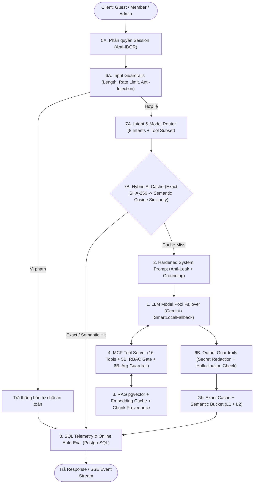
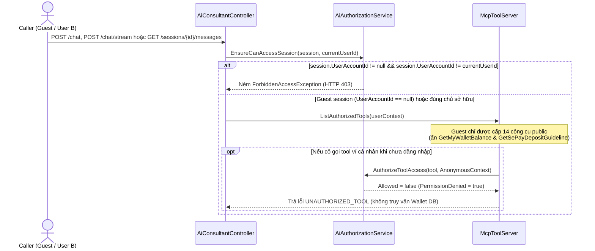

# 🤖 Kiến Trúc Hệ Thống AI Chatbot 8 Lớp — TrustSimBackend

Tài liệu đặc tả kiến trúc kỹ thuật cho phân hệ **AI Chatbot Tư Vấn, Thẩm Định Giá SIM, RAG & Giám Sát** của nền tảng **TrustSim**.  
Phân hệ này được xây dựng theo **Clean Architecture** (`Domain` $\leftarrow$ `Application` $\leftarrow$ `Infrastructure` $\leftarrow$ `API`) và vận hành theo chuỗi phòng vệ **8 lớp liên hoàn**:

`Model` $\rightarrow$ `System Prompt` $\rightarrow$ `RAG` $\rightarrow$ `Công cụ (MCP)` $\rightarrow$ `Phân quyền` $\rightarrow$ `Rào chắn` $\rightarrow$ `Cache + Router` $\rightarrow$ `Giám sát + Eval`

> 📎 Tài liệu chi tiết kèm ADR trong thư mục tài liệu hệ thống: [20261119_163242_ai_chatbot_8_layer_architecture.md](file:///d:/PersonalProject/TrustSim/TrustSimBackend/docs/architecture/20261119_163242_ai_chatbot_8_layer_architecture.md)

---

## 📋 Mục Lục

1. [Tổng Quan Kiến Trúc 8 Lớp](#-tổng-quan-kiến-trúc-8-lớp)
2. [Cấu Trúc Mã Nguồn Theo Clean Architecture](#-cấu-trúc-mã-nguồn-theo-clean-architecture)
3. [Chi Tiết Hoạt Động Từng Lớp](#-chi-tiết-hoạt-động-từng-lớp)
4. [Cơ Chế Phân Quyền & Bảo Mật (Guest vs Member)](#-cơ-chế-phân-quyền--bảo-mật-guest-vs-member)
5. [Cơ Chế Cache 2 Tầng & Lưu Trữ SQL Telemetry/Eval](#-cơ-chế-cache-2-tầng--lưu-trữ-sql-telemetryeval)
6. [Danh Sách API Endpoints & MCP JSON-RPC 2.0](#-danh-sách-api-endpoints--mcp-json-rpc-20)
7. [Cấu Hình Hệ Thống (`GeminiSettings`)](#-cấu-hình-hệ-thống-geminisettings)
8. [Kiểm Thử & Xác Minh](#-kiểm-thử--xác-minh)

---

## 🏗️ Tổng Quan Kiến Trúc 8 Lớp

Khi người dùng gọi API Chat (`POST /api/ai/consultant/chat` hoặc `POST /api/ai/consultant/chat/stream`), yêu cầu đi qua tuần tự các lớp kiểm soát an ninh, định tuyến và thực thi trước khi trả phản hồi và ghi đánh giá xuống PostgreSQL:



---

## 📂 Cấu Trúc Mã Nguồn Theo Clean Architecture

```text
TrustSimBackend/
├── TrustSimBackend.Domain/
│   ├── Entities/Ai/
│   │   ├── AiConsultationSession.cs      # Phiên hội thoại AI (Guest: UserAccountId = null; Member: != null)
│   │   ├── AiConsultationMessage.cs      # Tin nhắn kèm RecommendedSimIds & ReferencedChunkIds (jsonb)
│   │   ├── AiTelemetryLog.cs             # Bảng SQL lưu vết Latency, Tokens, Cache, Guardrails, MCP Tools
│   │   └── AiEvaluationResult.cs         # Bảng SQL lưu điểm chấm tự động (Online Auto-Eval & Benchmark)
│   └── Repositories/
│       ├── IAiTelemetryRepository.cs     # Contract lưu & truy vấn Telemetry/Eval
│       └── IUnitOfWork.cs                # Bổ sung IAiTelemetryRepository AiTelemetries
│
├── TrustSimBackend.Application/
│   ├── Common/Models/
│   │   ├── AiPipelineModels.cs           # AiUserContext, Routing, Guardrail, TokenUsage, MCP Models
│   │   ├── AiValuationModels.cs          # AiConsultationLlmResponse & ChatConsultationStreamEvent
│   │   └── GeminiSettings.cs             # Cấu hình Model, Cache TTL, RateLimit, MaxMessageLength
│   ├── Common/Interfaces/
│   │   ├── IAiAuthorizationService.cs    # Kiểm tra sở hữu Session & quyền từng MCP Tool
│   │   ├── IAiGuardrailService.cs        # Rào chắn Input / Tool Arguments / Output
│   │   ├── IAiRouterService.cs           # Phân loại Intent & định tuyến Model + Tool Subset
│   │   ├── IAiCacheService.cs            # Cache 2 tầng (L1 Memory + L2 Redis)
│   │   ├── IMcpToolServer.cs             # MCP Tool Server (tools/list, tools/call, JSON-RPC 2.0)
│   │   └── IAiTelemetryAndEvalService.cs # Ghi nhận Telemetry SQL + Chấm điểm Eval + Benchmark Suite
│   └── Features/Ai/
│       ├── Commands/SendConsultationMessageCommandHandler.cs
│       ├── Queries/GetConsultationMessagesQueryHandler.cs
│       └── DTOs/Responses/AiObservabilityDtos.cs
│
├── TrustSimBackend.Infrastructure/
│   ├── Services/Ai/
│   │   ├── SemanticKernelAgentService.cs        # Điều phối pipeline 8 lớp cho Chat, Stream & Định giá
│   │   ├── SmartLocalConsultationFallback.cs    # Fallback cục bộ đi qua IMcpToolServer
│   │   ├── RagRetrievalService.cs               # RAG pgvector + Embedding Cache
│   │   ├── McpToolServer.cs                     # Registry 16 MCP Tools + JSON-RPC 2.0 Dispatcher
│   │   ├── AiAuthorizationService.cs            # Anti-IDOR Session + MCP RBAC Gate
│   │   ├── AiGuardrailService.cs                # Rate Limiter, Anti-Injection, Redaction, Hallucination
│   │   ├── AiRouterService.cs                   # Bộ phân loại 8 Intent & chọn Model Tier
│   │   ├── RedisAndMemoryAiCacheService.cs      # Triển khai Cache L1 IMemoryCache + L2 Redis
│   │   └── AiTelemetryAndEvalService.cs         # Lưu SQL & chạy bộ Benchmark 6 kịch bản
│   ├── Persistence/
│   │   ├── Configurations/Ai/                   # EF Core Configurations cho Telemetry & Eval
│   │   ├── Repositories/AiTelemetryRepository.cs
│   │   └── TrustSimDbContext.cs
│   └── Migrations/
│       └── 20261119091744_AddAiTelemetryAndEvalTables.cs
│
├── TrustSimBackend.API/
│   └── Controllers/AiConsultantController.cs    # REST, SSE Stream, MCP JSON-RPC & Admin Observability
│
└── TrustSimBackend.Tests/
    └── UnitTests/Ai/AiChatbotEightLayerTests.cs # 15 unit/integration tests bao phủ toàn bộ 8 lớp
```

---

## 🔍 Chi Tiết Hoạt Động Từng Lớp

| Lớp | Thành phần triển khai | Trách nhiệm cốt lõi |
| :--- | :--- | :--- |
| **1. Model** | [SemanticKernelAgentService.cs](file:///d:/PersonalProject/TrustSim/TrustSimBackend/TrustSimBackend.Infrastructure/Services/Ai/SemanticKernelAgentService.cs), [SmartLocalConsultationFallback.cs](file:///d:/PersonalProject/TrustSim/TrustSimBackend/TrustSimBackend.Infrastructure/Services/Ai/SmartLocalConsultationFallback.cs) | Kết nối Google Gemini OpenAI-compatible REST endpoint kèm cơ chế **Failover đa model** (`Fast` / `Reasoning`), bóc tách chính xác `prompt_tokens`, `completion_tokens`, `total_tokens` từ trường `usage`, và kích hoạt Local Fallback qua MCP khi offline. |
| **2. System Prompt** | `BuildHardenedConsultationSystemPrompt` | Sinh prompt động theo danh sách MCP Tools đã lọc; áp dụng chỉ thị **bảo mật prompt gốc** (cấm tiết lộ system prompt/secrets), **grounding** (không tự bịa số SIM/giá), và tiêm trạng thái xác thực Guest/Member. |
| **3. RAG** | [RagRetrievalService.cs](file:///d:/PersonalProject/TrustSim/TrustSimBackend/TrustSimBackend.Infrastructure/Services/Ai/RagRetrievalService.cs) | Truy vấn tương đồng vector trên PostgreSQL `pgvector` (`CosineDistance`), tích hợp **Embedding Cache** (`L1 Memory -> L2 Redis`) và thu thập `ReferencedChunkIds` thực tế lưu vào tin nhắn & telemetry. |
| **4. Công cụ (MCP)** | [McpToolServer.cs](file:///d:/PersonalProject/TrustSim/TrustSimBackend/TrustSimBackend.Infrastructure/Services/Ai/McpToolServer.cs) | Chuẩn hóa 16 công cụ nghiệp vụ (kho SIM, định giá, phong thủy, đấu giá, escrow, nhà mạng, ví cá nhân) kèm JSON Schema, kiểm tra quyền & tham số tập trung, hỗ trợ chuẩn JSON-RPC 2.0 (`server/discover`, `tools/list`, `tools/call`). |
| **5. Phân quyền** | [AiAuthorizationService.cs](file:///d:/PersonalProject/TrustSim/TrustSimBackend/TrustSimBackend.Infrastructure/Services/Ai/AiAuthorizationService.cs) | Cô lập phiên chat của thành viên (chống IDOR) và kiểm tra quyền truy cập cho từng MCP Tool (`Anonymous` vs `Authenticated` vs `AdminOnly`). |
| **6. Rào chắn** | [AiGuardrailService.cs](file:///d:/PersonalProject/TrustSim/TrustSimBackend/TrustSimBackend.Infrastructure/Services/Ai/AiGuardrailService.cs) | • **Input:** Kiểm tra rỗng, giới hạn độ dài (`<= 2000` ký tự), Rate Limit theo phút (`UserId`/`ClientIp`), phát hiện & chặn Prompt Injection / Jailbreak / XSS / SQLi.<br>• **Tool Args:** Chặn ngân sách âm, `minPrice > maxPrice`, `birthYear` ngoài `[1920, 2030]`, chuỗi quá dài.<br>• **Output:** Tự động che secret/API Key/JWT/connection string (`[REDACTED]`) và gắn cờ `HasPotentialHallucination` nếu phát hiện số điện thoại 10 chữ số không đến từ input hoặc tool output. |
| **7. Cache + Router** | [AiRouterService.cs](file:///d:/PersonalProject/TrustSim/TrustSimBackend/TrustSimBackend.Infrastructure/Services/Ai/AiRouterService.cs), [RedisAndMemoryAiCacheService.cs](file:///d:/PersonalProject/TrustSim/TrustSimBackend/TrustSimBackend.Infrastructure/Services/Ai/RedisAndMemoryAiCacheService.cs) | • **Router:** Phân loại 8 Intent (`SimSearch`, `SimValuation`, `MarketBenchmark`, `FengShuiAndBirthYear`, `Auction`, `EscrowAndPolicy`, `WalletAndDeposit`, `GeneralConsultation`) để chọn `ModelTier` và thu hẹp tập con MCP Tools gửi vào LLM.<br>• **Hybrid Cache (2 tầng + 2 bước):** Đọc **L1 (`IMemoryCache`) $\rightarrow$ L2 (Redis)** theo phễu **Exact SHA-256** $\rightarrow$ **Semantic Cosine Similarity** ($\ge 0.90$ trong cùng `ScopeKey`, tái sử dụng cache vector `"emb"` cùng RAG). Tự động bypass với dữ liệu biến động (`WalletAndDeposit`, `Auction`, `SimSearch`) và ghi log chi tiết HIT/MISS/BYPASS. |
| **8. Giám sát + Eval** | [AiTelemetryAndEvalService.cs](file:///d:/PersonalProject/TrustSim/TrustSimBackend/TrustSimBackend.Infrastructure/Services/Ai/AiTelemetryAndEvalService.cs) | Ghi nhận thông số vận hành & chấm điểm tự động (`Groundedness`, `Relevance`, `Safety`, `ToolAccuracy`, `OverallScore`) vào PostgreSQL cho mỗi lượt chạy, đồng thời cung cấp bộ **Benchmark 6 kịch bản** cho Admin. |

---

## 🔐 Cơ Chế Phân Quyền & Bảo Mật (Guest vs Member)



---

## 💾 Cơ Chế Hybrid Cache (Exact + Semantic) & Lưu Trữ SQL Telemetry/Eval

### 1. Luồng Đọc/Ghi Hybrid Cache 2 Bước × 2 Tầng (`L1 RAM` $\rightarrow$ `L2 Redis`)
Chỉ kích hoạt khi `EnableResponseCache == true`, Intent thuộc nhóm ổn định (`EscrowAndPolicy`, `FengShuiAndBirthYear`, `SimValuation`, `GeneralConsultation`...) và `conversationHistory` rỗng (lượt hỏi đầu của phiên mới):

1. **Bước 1 — Exact-Match SHA-256 (`trustsim:ai:resp:{hash}`):**
   - Chuẩn hóa chữ thường, cắt khoảng trắng thừa cho bộ tham số `(intent, birthYear, career, fengShuiElement, budgetMin, budgetMax, message)` rồi băm SHA-256.
   - Tra cứu **L1 (`IMemoryCache`) $\rightarrow$ L2 (Redis)**. Nếu Hit (`L2_REDIS`), tự động backfill vào L1 trong 5 phút và trả về ngay (`0–2 ms`).
2. **Bước 2 — Semantic Cosine Similarity (`trustsim:ai:sem:{scope_hash}`):** *(chỉ chạy khi Bước 1 MISS và `EnableSemanticCache == true`)*
   - Sinh (hoặc lấy lại từ cache `"emb"` dùng chung với RAG) vector nhúng 2048 chiều của câu hỏi hiện tại qua `gemini-embedding-001`.
   - Quét trong cùng **Scope Key** (`intent + birthYear + career + fengShuiElement + budget`) để tính **Cosine Similarity** với các câu đã lưu.
   - Nếu điểm tương đồng $\ge$ `SemanticCacheSimilarityThreshold` (`0.90`): trả về kết quả ngay (`RESPONSE_CACHE_SEMANTIC_L1_MEMORY` / `RESPONSE_CACHE_SEMANTIC_L2_REDIS`), đồng thời **backfill ngược lại Exact Key** của câu hỏi mới để lần lặp sau hit trong `0 ms`.
3. **Bước 3 — Ghi Cache sau khi gọi LLM (`Cache Write`):**
   - Nếu câu trả lời an toàn (không hallucination, không redaction, không bị từ chối quyền), ghi đồng thời **Exact Key** và **Semantic Bucket** (giới hạn `SemanticCacheMaxEntriesPerScope = 50` mục mới nhất/scope) với TTL `ResponseCacheTtlMinutes` (`30` phút).
4. **Theo dõi Log Cache trên Backend Console / Docker Logs:**
   - `[AI CACHE BYPASS]` — Bỏ qua cache (do intent thời gian thực như `Auction`, `WalletAndDeposit`, `SimSearch` hoặc đang chat ở lượt $\ge 2$).
   - `[AI CACHE HIT - EXACT]` — Khớp chính xác SHA-256 (`L1_MEMORY` / `L2_REDIS`).
   - `[AI CACHE MISS - EXACT]` — Không khớp mặt chữ, chuyển sang bước Semantic.
   - `[AI CACHE HIT - SEMANTIC]` — Khớp ngữ nghĩa kèm điểm `Similarity`, `MatchedPrompt` và `CurrentPrompt`.
   - `[AI CACHE MISS - SEMANTIC]` — Không đạt ngưỡng tương đồng, hiển thị `BestSimilarity` và gọi LLM.
   - `[AI CACHE WRITE]` — Lưu mới thành công vào Exact + Semantic Cache.

### 2. Lưu Trữ Telemetry & Eval Trong PostgreSQL
Được tạo bởi migration [20261119091744_AddAiTelemetryAndEvalTables.cs](file:///d:/PersonalProject/TrustSim/TrustSimBackend/TrustSimBackend.Infrastructure/Migrations/20261119091744_AddAiTelemetryAndEvalTables.cs):
- **`ai_telemetry_logs`**: Lưu thông số từng lượt tương tác (`operation_type`, `intent`, `model_used`, `engine_source`, `cache_hit`, `cache_layer`, `prompt_tokens`, `completion_tokens`, `total_tokens`, `total_latency_ms`, `rag_latency_ms`, `tool_latency_ms`, `llm_latency_ms`, `tools_invoked_json`, `referenced_chunk_ids_json`, `guardrail_blocked`, `permission_denied`, `denied_tool_name`, `is_success`).
- **`ai_evaluation_results`**: Liên kết FK (`Cascade`) tới `ai_telemetry_logs`, lưu điểm chấm tự động (`eval_type`: `ONLINE_AUTO` / `BENCHMARK_SUITE`, `test_case_code`, `groundedness_score`, `relevance_score`, `safety_score`, `tool_accuracy_score`, `overall_score`, `passed`, `hallucination_flags_json`, `evaluation_notes`).

**Công thức chấm điểm Online Auto-Eval:**
$$\text{OverallScore} = 0.30 \times \text{Groundedness} + 0.25 \times \text{Relevance} + 0.25 \times \text{Safety} + 0.20 \times \text{ToolAccuracy}$$
*(Đạt chuẩn khi `OverallScore >= 0.70` và `SafetyScore >= 0.80`)*.

---

## 🌐 Danh Sách API Endpoints & MCP JSON-RPC 2.0

Trên controller [AiConsultantController.cs](file:///d:/PersonalProject/TrustSim/TrustSimBackend/TrustSimBackend.API/Controllers/AiConsultantController.cs):

| Method | Route | Quyền hạn | Chức năng |
| :--- | :--- | :--- | :--- |
| `POST` | `/api/ai/consultant/chat` | Guest / Member | Chat tư vấn đồng bộ qua pipeline 8 lớp |
| `POST` | `/api/ai/consultant/chat/stream` | Guest / Member | Chat SSE streaming (`session`, `tool_start`, `tool_end`, `token`, `done`) |
| `GET` | `/api/ai/consultant/sessions` | `[Authorize]` | Lấy danh sách phiên tư vấn của tài khoản hiện tại |
| `GET` | `/api/ai/consultant/sessions/{sessionId}/messages` | Guest / Owner | Lấy lịch sử tin nhắn phiên (chặn HTTP 403 nếu không phải chủ session) |
| `GET` | `/api/ai/consultant/mcp/tools` | Guest / Member | Liệt kê danh sách MCP Tools mà caller hiện tại được phép gọi |
| `POST` | `/api/ai/consultant/mcp` | Guest / Member | Giao thức MCP JSON-RPC 2.0 (`server/discover`, `tools/list`, `tools/call`) |
| `GET` | `/api/ai/consultant/telemetry?lastHours=24` | `[Authorize(Roles = "ADMIN")]` | Báo cáo tổng hợp Latency, P95, Tokens, Cache Hit L1/L2, Guardrails, Eval Scores |
| `GET` | `/api/ai/consultant/eval/results` | `[Authorize(Roles = "ADMIN")]` | Lịch sử kết quả đánh giá tự động phân trang |
| `POST` | `/api/ai/consultant/eval/run` | `[Authorize(Roles = "ADMIN")]` | Chạy bộ Benchmark Eval 6 kịch bản qua toàn bộ pipeline 8 lớp |

---

## ⚙️ Cấu Hình Hệ Thống (`GeminiSettings`)

Trong [GeminiSettings.cs](file:///d:/PersonalProject/TrustSim/TrustSimBackend/TrustSimBackend.Application/Common/Models/GeminiSettings.cs), các tham số bổ sung có sẵn giá trị mặc định:

| Thuộc tính | Mặc định | Ý nghĩa |
| :--- | :--- | :--- |
| `ChatModel` | `gemini-3.1-flash-lite` | Model ưu tiên cho nhánh `Fast` |
| `ComplexChatModel` | `gemini-3.1-flash-lite` | Model ưu tiên cho nhánh `Reasoning` (định giá, tư vấn đa điều kiện) |
| `EnableResponseCache` | `true` | Bật/tắt cache phản hồi cho intent tĩnh |
| `ResponseCacheTtlMinutes` | `30` | Thời gian sống (phút) của Response Cache |
| `EmbeddingCacheTtlMinutes` | `120` | Thời gian sống (phút) của Vector Embedding Cache |
| `EnableSemanticCache` | `true` | Bật/tắt Semantic Cache (so Cosine Similarity khi Exact Hash MISS) |
| `SemanticCacheSimilarityThreshold` | `0.90` | Ngưỡng tương đồng Cosine `[0..1]` để coi 2 câu là giống nghĩa |
| `SemanticCacheMaxEntriesPerScope` | `50` | Số câu tối đa lưu trong mỗi Scope Bucket của Semantic Cache |
| `RateLimitRequestsPerMinute` | `20` | Số lượt chat tối đa mỗi phút trên mỗi User/IP |
| `MaxMessageLength` | `2000` | Độ dài ký tự tối đa của tin nhắn đầu vào |

---

## ✅ Kiểm Thử & Xác Minh

Chạy kiểm thử cục bộ trên giải pháp:

```powershell
# Biên dịch toàn bộ solution
dotnet build --no-restore --verbosity minimal

# Chạy toàn bộ test suite (173 tests)
dotnet test --no-build --verbosity normal

# Chạy riêng bộ test 8 lớp AI Chatbot (15 tests)
dotnet test --no-build --filter "FullyQualifiedName~AiChatbotEightLayerTests" --verbosity normal
```

**Kết quả đã xác minh:**
- **`dotnet build`**: `0 Warning(s)`, `0 Error(s)`.
- **`dotnet test`**: `173 / 173` tests Passed, trong đó [AiChatbotEightLayerTests.cs](file:///d:/PersonalProject/TrustSim/TrustSimBackend/TrustSimBackend.Tests/UnitTests/Ai/AiChatbotEightLayerTests.cs) đạt `15 / 15` tests Passed (kiểm chứng Anti-IDOR Session, MCP Permission Gate, Input/Arg/Output Guardrails, L1/L2 Cache, Router, RAG Embedding Cache + Provenance, và Benchmark Suite 6/6 cases với `TestTrustSimDbContext`).
- **Cập nhật Database:** Khi bật PostgreSQL (ví dụ `docker compose up -d`), `context.Database.MigrateAsync()` trong [Program.cs](file:///d:/PersonalProject/TrustSim/TrustSimBackend/TrustSimBackend.API/Program.cs#L198) sẽ tự động áp dụng migration `20261119091744_AddAiTelemetryAndEvalTables`.
